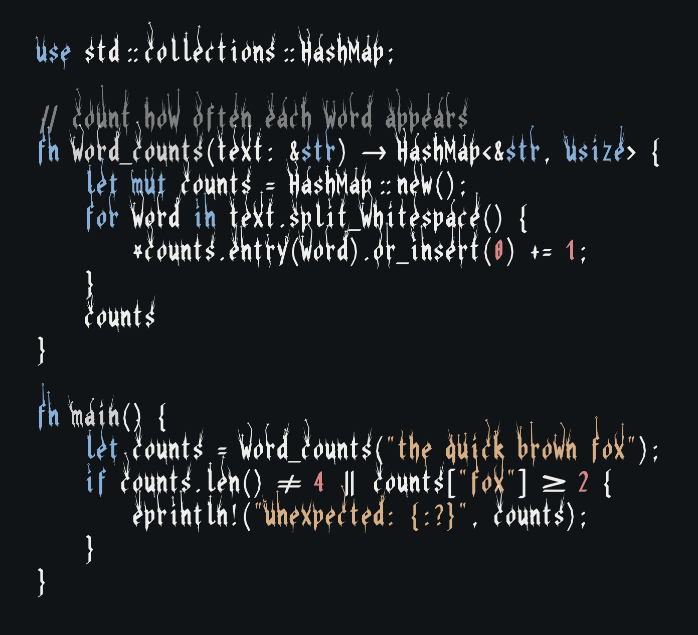

<h1 align="center">necromono</h1>

A black metal monospace font for programmers.

  

## Install

Download the four files in [`fonts/`](fonts), install them, and choose
**necromono** in your terminal or editor. In Ghostty:

    font-family = necromono

It is sharpest at 13pt on a Retina display.

## What you get

- Regular, Bold, Italic and Bold Italic. The italic is not slanted: it is the
  regular with more growing out of it.
- Ligatures for common operators. They never change the width of anything.
- 594 characters, including accented Latin, box drawing and the symbols
  terminal programs print. [See them all.](docs/specimen.png)

## Too much?

| To turn off | In Ghostty |
|---|---|
| Ligatures | `font-feature = -liga` |
| Horns on words | `font-feature = -calt` |
| Everything that grows from the letters | `font-feature = ss01` |

## Licence

[SIL Open Font License 1.1](OFL.txt)
