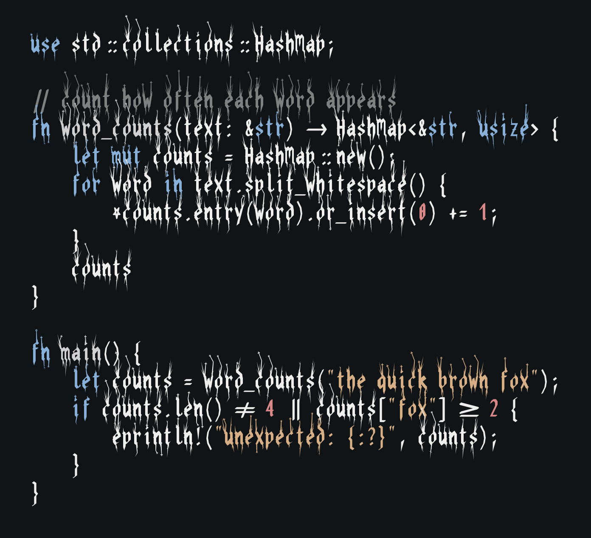

<h1 align="center">necromono</h1>

A black metal monospace font.

  

## Install

Download the four files in [`fonts/`](fonts), install them, and choose
**necromono** in your terminal or editor.

It is drawn for 13pt on a high-density (Retina) display. On an ordinary
display it is soft at that size, and wants to be set larger.

## What you get

- Regular, Bold, Italic and Bold Italic. The italic is not slanted: it is the
  regular with more growing out of it.
- Ligatures for common operators. They never change the width of anything.
- 594 characters, including accented Latin, box drawing and the symbols
  terminal programs print. [See them all.](docs/characters-823a2f0d.png)

## Too much?

These are standard OpenType features, so any terminal or editor that lets you
set font features can switch them.

| To turn off | Feature |
|---|---|
| Ligatures | `liga` off |
| Horns on words | `calt` off |
| Everything that grows from the letters | `ss01` on |

## Licence

[SIL Open Font License 1.1](OFL.txt)
