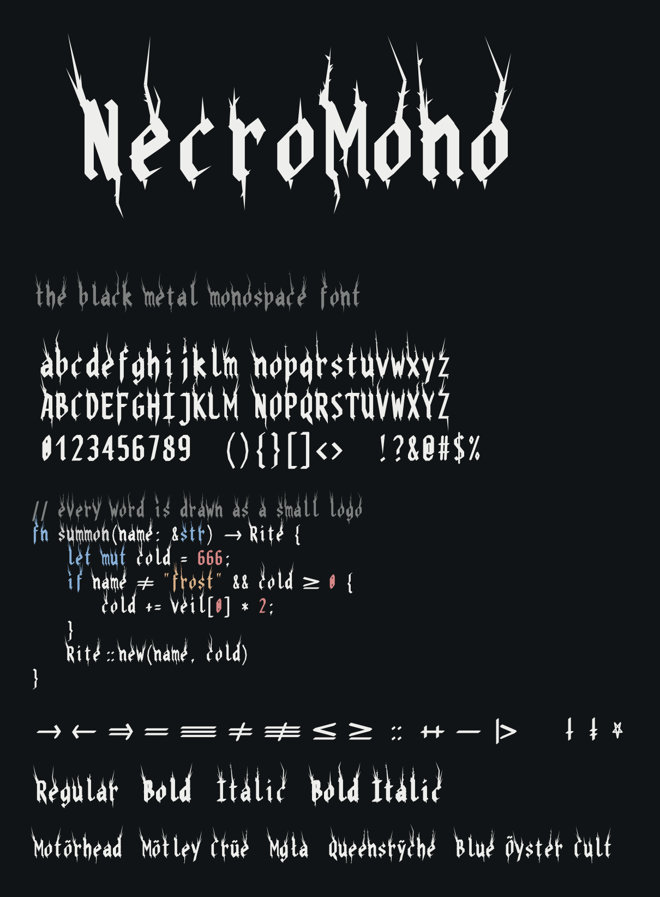

# NecroMono

A black metal monospace font for programmers.

Blackletter drawn for a terminal: every character advances exactly one cell,
while the ink is free to leave it.

## What is in it

- **Four styles**: Regular, Bold, Italic and Bold Italic. The italics are not
  slanted; they are the same letters with more growing out of them, so
  comments set in italic come out wilder than code.
- **Drawn for the pixel grid.** At 13pt on a Retina display the cell is
  12 x 33 px, stems are exactly 3 px (4 px in bold) with both edges on pixel
  boundaries, and the x-height is 15 px. macOS ignores font hinting, so this
  is done in the drawing itself.
- **Every word is a small logo.** The first and last letters of a word throw a
  mirrored pair of horns outward, and letters inside a word cycle through
  alternate drawings so a repeated letter is never a stamp (`calt`).
- **Ligatures** for `->` `<-` `=>` `==` `===` `!=` `!==` `<=` `>=` `::` `++`
  `--` `|>`. Each keeps its cells, so columns never move (`liga`).
- **192 characters**: ASCII, accented Latin (metal umlauts included), shell
  and maths symbols, inverted crosses and a pentagram.

To turn the word shaping or the ligatures off, disable `calt` or `liga` in
your terminal or editor. In Ghostty: `font-feature = -liga`.

## Build

    python3 -m venv .venv && .venv/bin/pip install -r requirements.txt
    .venv/bin/python -m necromono.build       # writes fonts/NecroMono-*.ttf
    ./show.sh                                 # build, install, open a Ghostty preview

The font is generated: `necromono/textura.py` holds the letters,
`necromono/pen.py` the pen that inks them.

## Checking it

    .venv/bin/python -m necromono.eyes        # render terminal text exactly as Ghostty draws it
    .venv/bin/python -m necromono.judge       # which characters could be mistaken for each other at 13pt
    .venv/bin/python -m necromono.texture     # density and spikiness, against real black metal logos
    .venv/bin/python -m necromono.validate    # Font Bakery
    .venv/bin/python -m necromono.specimen    # redraw the sheet above

`eyes`, `judge` and `texture` need macOS (Core Text) and compare against Menlo.
